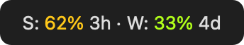
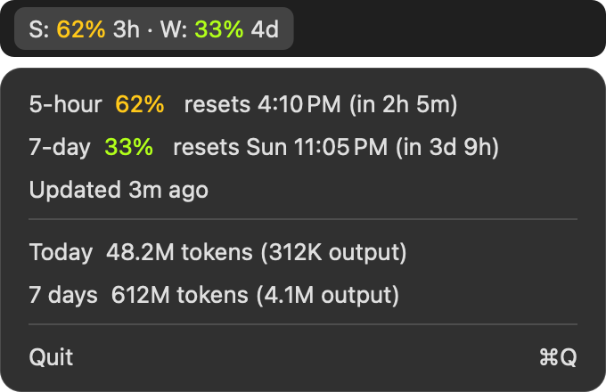

# Usage tracker

Shows your Claude Code plan limits in the Mac menu bar.



Click it to see reset times and token totals:



_Previews rendered from the app's own title, rows and colors, using sample
numbers. They aren't screen captures, so the bar and panel behind the text will
look slightly different on your Mac._

## Download and install

You need:

- macOS 13 or later (tested on macOS 26).
- Xcode Command Line Tools: `xcode-select --install`.
- `jq`: `brew install jq`.
- A Claude Pro, Max or Ultra plan, because only these report limits.
- A Claude Code status line. If you don't have one, run `/statusline` in Claude
  Code to create one. The installer stops without it.

Then download it and run the installer:

```bash
git clone https://github.com/xcollantes/claude-usage.git
cd claude-usage
./install.sh
```

The tracker starts right away and at every login. Limits show `–` until the
next Claude Code response.

The install makes these changes:

- `~/.local/bin/usage-tracker`: adds the binary.
- `~/Library/LaunchAgents/local.usage-tracker.plist`: starts it at login.
- `~/.claude/settings.json`: adds a prefix to `statusLine.command`.
- `~/.claude/usage-tracker/rate-limits.json`: holds the latest limits.

## Use

There's nothing to run: keep using Claude Code and the title updates itself.

- `S:` is the 5-hour session limit and `W:` is the weekly limit.
- Each shows the percent used, then the time until it resets, rounded up.
  `S: 62% 3h` means 62% used, resetting within 3 hours.
- Percents run from green at 0% through yellow to red at 100%.
- Click the title to see exact reset times, when the limits last changed, and
  token totals for today and the last 7 days.
- Quit closes it until your next login. Run `./install.sh` to start it sooner.

If you can't see the title, your menu bar may be too full to fit it. Close some
other menu bar items to make room.

To update, run this from the `claude-usage` folder:

```bash
git pull
./install.sh
```

To remove everything:

```bash
./install.sh uninstall
```

## Where the numbers come from

**Limits** come from the `rate_limits` field Claude Code sends to status line
commands. The tracker sits in front of your existing status line, passes its
input through unchanged and saves the limits. It never reads your login token.

**Token totals** come from the transcripts in `~/.claude/projects`, including
subagents. Each message counts once. The total includes input, output, cache
writes and cache reads, so output is shown separately. Today starts at local
midnight, and 7 days is a rolling window.

## Known limits

- Limits refresh only when a Claude Code session on this Mac responds. Usage
  from claude.ai or another machine shows up on the next response.
- "Updated" is when a value last changed, so it can look old during light use.
- A window past its reset time shows 0% until the next response reports it.
- The feed has no per-model limits, such as a weekly Sonnet limit.
- Token totals cover this Mac only.

## Checks

```bash
swiftc -O main.swift selfcheck.swift -o /tmp/usage-tracker
/tmp/usage-tracker --self-check
/tmp/usage-tracker --print
```

`--print` shows what the menu would show. Set `CLAUDE_CONFIG_DIR` to read from
another directory.
